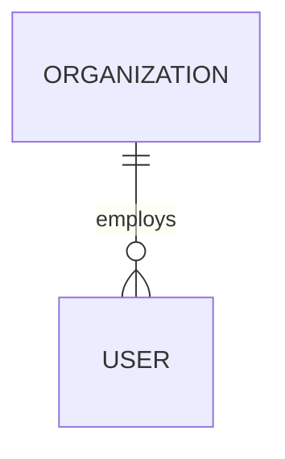

# {Product Name} — Product Architecture

> Status: Draft v{n} · Build level target: L{1–4} · Last updated: {date}

## 1. Purpose
- **One-liner:** {For [audience] who [problem], {Product} is a [category] that [key benefit]. Unlike [alternative], it [differentiator].}
- **Problem & why now:**
- **North-star metric:**
- **Supporting metrics:** 1. … 2. … 3. …

## 2. Assumptions
| # | Assumption | Rationale | Impact if wrong | Reversible? |
|---|---|---|---|---|
| A1 | | | | |

## 3. Audiences & personas
### {Persona name} — {role}, {org type}, {geography}
- Goals:
- Frustrations:
- Fluency / decision power:
- Gives / gets from the platform:

## 4. Jobs-to-be-done
| Persona | When… | I want to… | So I can… | Critical for MVP |
|---|---|---|---|---|

## 5. Core entities
| Entity | Key fields | Lifecycle states | Owner | Relationships |
|---|---|---|---|---|

## 6. Workflows
### W1 — {name}
1. {Actor} does … → state `draft`
2. System … (notification / AI step)
3. {Actor} approves → state `approved`
- Failure paths:
- SLAs / timers:

## 7. Public vs. authenticated
| Surface | Anonymous | Signed-in | Role/plan gate |
|---|---|---|---|

## 8. Role-specific environments
See multi-audience matrix (one column per audience).

## 9. Information architecture
- Public site map:
- App map per role:

## 10. Page inventory
| Route | Audience | Purpose | Key components | Primary action | Data | States |
|---|---|---|---|---|---|---|

## 11. Capabilities
- Discovery/search:
- Transactions:
- Collaboration:
- Documents/files:
- Analytics:
- AI intelligence:
- Admin/governance:
- Notifications:
- Integrations:

## 12. Permissions matrix
| Resource / action | Anonymous | Role A | Role B | Org admin | Platform admin |
|---|---|---|---|---|---|

## 13. Scope
| Now (MVP) | Next | Later |
|---|---|---|

## 14. Backend systems & integrations
| System | Purpose | MVP? | Real or simulated initially | Notes |
|---|---|---|---|---|
