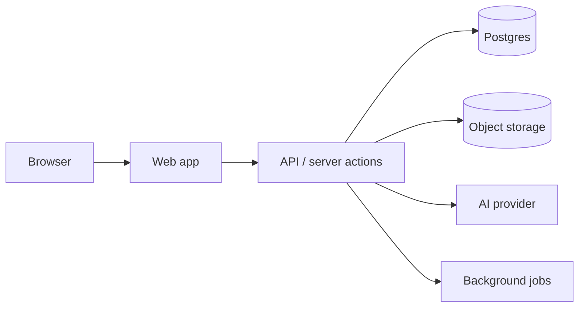

# {Product} — Developer Handoff

## Overview
- Build level delivered: L{n} — {one line}
- Stack:
- Live URL / how to run locally:

## Architecture


## Data model
- ERD:
- Lifecycle states per entity:

## APIs / server actions
| Method & path / action | Purpose | Auth | Roles | Input | Output |
|---|---|---|---|---|---|

## Authentication
## Authorization (permissions matrix)
## Integrations
## AI services (models, prompts location, fallbacks, evaluation)
## Storage (buckets, access, signed URL policy)
## Environment variables
| Name | Purpose | Required | Example |
|---|---|---|---|

## Run, seed, test, deploy
```bash
# install / migrate / seed / dev / test / build
```

## REAL vs. SIMULATED
| Capability | Status | Notes / what's needed for real |
|---|---|---|
| Auth (email/password) | Real | |
| Payments | Simulated | Needs Stripe keys + webhook endpoint |
| AI matching | Real with deterministic fallback | Set `AI_API_KEY` |

## Demo accounts (demo only)
| Role | Email | Password |
|---|---|---|

## Remaining production requirements
## Known limitations
## Recommended next steps
